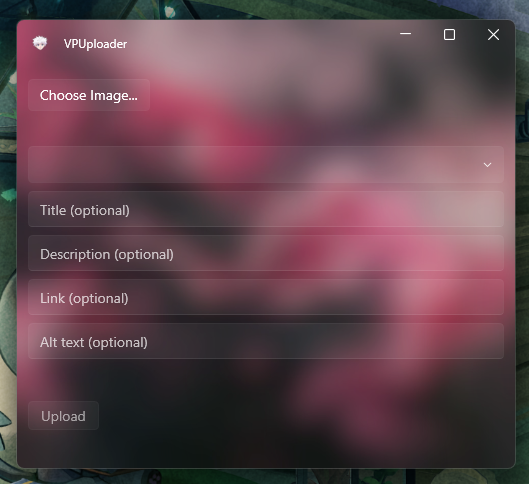

# VPUploader

A Windows desktop app for uploading images to Pinterest via the Pinterest API v5, with a right-click "Upload with VPUploader" entry in Windows Explorer. Built in C# / WPF, with a fully unit-tested core that has zero network, filesystem, or browser dependencies.

Website: [nxchos.dev.ar](https://nxchos.dev.ar) · Source: [github.com/nxsaldano/VPUploader](https://github.com/nxsaldano/VPUploader)



## Download

Grab the latest build from the [Releases page](https://github.com/nxsaldano/VPUploader/releases).

## Features

- Pick an image and upload it directly to a Pinterest board
- Fill in optional pin fields (title, multi-line description, link, alt text) — only the ones you actually use
- Board list loaded live from your Pinterest account
- OAuth 2.0 login: a "Connect to Pinterest" button starts the one-time browser authorization; after that, the app signs in silently on startup
- Clickable "View pin on Pinterest" link after each successful upload
- Fluent/Acrylic dark-themed UI (via [WPF-UI](https://github.com/lepoco/wpfui))
- Right-click "Upload with VPUploader" context-menu entry for image files in Windows Explorer (registered automatically on first launch, no admin rights needed)
## Current status

VPUploader currently runs on Pinterest's **Trial** API access, which is a sandbox: pins and boards created through it are only visible to the account that created them. The app therefore talks to `api-sandbox.pinterest.com`. Standard access (which makes pins publicly visible) is the next milestone.

## Architecture

- **`VPUploader.Core`** — OAuth flow and token refresh (`AuthService`), the Pinterest API client (`PinterestClient`), and the data models.
- **`VPUploader.Core.Tests`** — xUnit test suite that uses a fake HTTP handler, in-memory token store, and a fake token provider.
- **`VPUploader.App`** — WPF front end (MVVM).
  This split was a deliberate choice to make the OAuth/API logic verifiable without needing live Pinterest credentials for every test run.

## Getting started

**Prerequisites:** [.NET 8 SDK](https://dotnet.microsoft.com/download/dotnet/8.0)

1. Clone the repo
2. Register your own app on the [Pinterest Developer portal](https://developers.pinterest.com/) and add `http://localhost:8756/callback/` as a redirect URI
3. Create `VPUploader.App/appsettings.local.json` with your own credentials (this file is gitignored):
```json
   {
     "Pinterest": {
       "ClientId": "YOUR_APP_ID",
       "ClientSecret": "YOUR_APP_SECRET"
     }
   }
```
4. Build and run:
```
   dotnet build
   dotnet run --project VPUploader.App
```
5. Click **Connect to Pinterest** and approve access in your browser
   To run the test suite instead:
```
dotnet test
```

## Permissions requested

VPUploader asks Pinterest for `boards:read`, `boards:write`, `pins:read` and `pins:write`. Pinterest requires board-write permission for the pin-creation endpoint; the app does not edit or delete your existing boards. See the [privacy policy](privacy-policy.md).

## Tech stack

C# · .NET 8 · WPF · [WPF-UI](https://github.com/lepoco/wpfui) · xUnit · Pinterest API v5

## Acknowledgments

Built with architectural guidance and code review from Claude (Anthropic).

## License

MIT